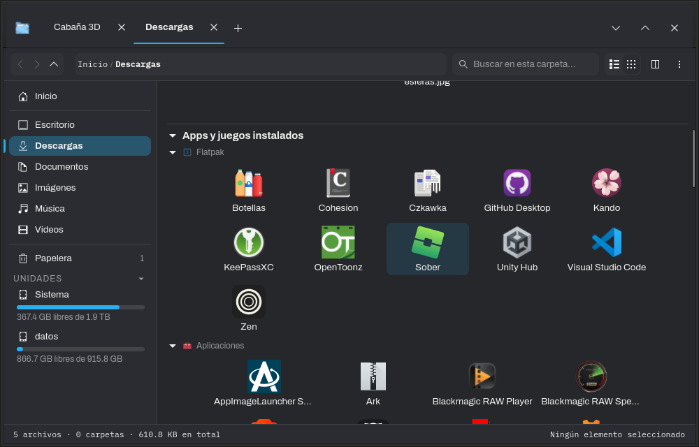

<p align="center">
  
</p>

<h1 align="center">Waypoint Explorer</h1>

<p align="center">
  A file manager for Linux that does the things other file managers leave to you.
</p>

<p align="center">
  <a href="https://github.com/Amariless/waypoint-explorer-releases/releases/latest/download/waypoint-explorer-linux-x86_64.tar.gz"></a>
</p>

<p align="center">
  
</p>

## What makes it different

<table>
  <tr>
    <td width="50%">
      <h3>Rename any app on your system</h3>
      <p>Some launchers have names that tell you nothing. Right-click any installed app and give it a name you'll recognize, even Waypoint itself, so it can show up simply as "File Explorer".</p>
      <p>The new name appears everywhere: the app menu, search and "Open with", not just inside Waypoint. The original app isn't touched.</p>
    </td>
    <td width="50%">
      <h3>Files that belong together stay together</h3>
      <p>A <code>.blend</code> file and its backups, or a texture and its normal, roughness and metallic maps, show up as a single item with a small counter. Open it to see the rest.</p>
      <p>Moving or deleting the main file can take its companions along. You can write your own rules for any kind of file.</p>
    </td>
  </tr>
  <tr>
    <td width="50%"></td>
    <td width="50%">
      <h3>Your apps and games, right in Downloads</h3>
      <p>Below your downloads, Waypoint lists everything you have installed: Steam and Heroic games with their own icons, Flatpaks, AppImages and regular apps.</p>
      <p>Open them, jump to where they're installed, rename them or uninstall them from the same place.</p>
    </td>
  </tr>
</table>

**Also unique to Waypoint**

- **Notes on any file or folder**, to remember what something is or what's left to do with it.
- **Hide files without renaming them.** No need to add a dot to the name.
- **Your own icon for any folder**, and full custom icon themes.

## Everything else you'd expect

<details>
<summary><b>Getting around</b></summary>
<br>

- Tabs you can drag out into their own window, and a split view with two panes.
- A path bar where you can type or paste any address.
- Search by name or by content, ignoring case and accents, with wildcards like `*.png`.
- Quick preview with the space bar.
- Set it as your default file manager. In KDE Plasma it also takes over <kbd>Meta</kbd>+<kbd>E</kbd>, and "Show in folder" from your browser, Discord or Steam opens a tab in Waypoint.

</details>

<details>
<summary><b>Working with files</b></summary>
<br>

- Copy, move and drag with a progress bar and a cancel button.
- A real trash bin with restore, batch renaming and undo.
- Open archives (zip, 7z, tar and more) as if they were folders.
- Thumbnails for photos, videos, album covers and Blender files, including AVIF, HEIC and camera RAW.

</details>

<details>
<summary><b>Built-in tools</b></summary>
<br>

- A duplicate file finder.
- A disk usage analyzer to see what's taking up space.
- Properties with permissions, checksums and details for each type of file.

</details>

## Download

Waypoint Explorer runs on 64-bit Linux with GTK 4.10 or newer. It's made for KDE Plasma but works on any desktop. The interface is in Spanish for now.

1. [Download the .tar.gz](https://github.com/Amariless/waypoint-explorer-releases/releases/latest/download/waypoint-explorer-linux-x86_64.tar.gz).
2. Extract it and run the installer:

```bash
mkdir waypoint-explorer && tar -xzf waypoint-explorer-linux-x86_64.tar.gz -C waypoint-explorer
cd waypoint-explorer
./instalar.sh
```

It doesn't ask for an administrator password: it installs into your home folder and adds itself to the app menu. To make it your default file manager, go to *Preferences → System*.

To uninstall it, run `./desinstalar.sh` from the same folder. Your notes, bookmarks and preferences stay in `~/.local/share/waypoint-explorer` in case you come back.

To update, use *Preferences → System → Check for updates*. It downloads the new version and restarts by itself.

<details>
<summary><b>Optional programs for extra features</b></summary>
<br>

Some features use other programs. If one isn't installed, that feature just doesn't show up.

| Program | Used for |
|---|---|
| `p7zip` | Opening and editing archives |
| `ffmpeg`, `ffmpegthumbnailer` | Video thumbnails and unusual formats |
| `imagemagick`, `librsvg`, `libavif` | Thumbnails for PSD, RAW, SVG and AVIF |
| `exiv2`, `poppler` | Photo and PDF details |

On Arch and its derivatives you can install all of them with:

```bash
sudo pacman -S p7zip ffmpeg ffmpegthumbnailer imagemagick librsvg libavif exiv2 poppler
```

It's built on CachyOS (Arch), so it may not start on very old distributions.

</details>

## Feedback

Found a bug, have an idea or just want to say something? Each button opens a short form.

<p>
  <a href="https://github.com/Amariless/waypoint-explorer-releases/issues/new?template=bug.yml"></a>
  <a href="https://github.com/Amariless/waypoint-explorer-releases/issues/new?template=idea.yml"></a>
  <a href="https://github.com/Amariless/waypoint-explorer-releases/issues/new?template=comment.yml"></a>
</p>

---

<sub>This repository only hosts the program; the source code is private.</sub>
