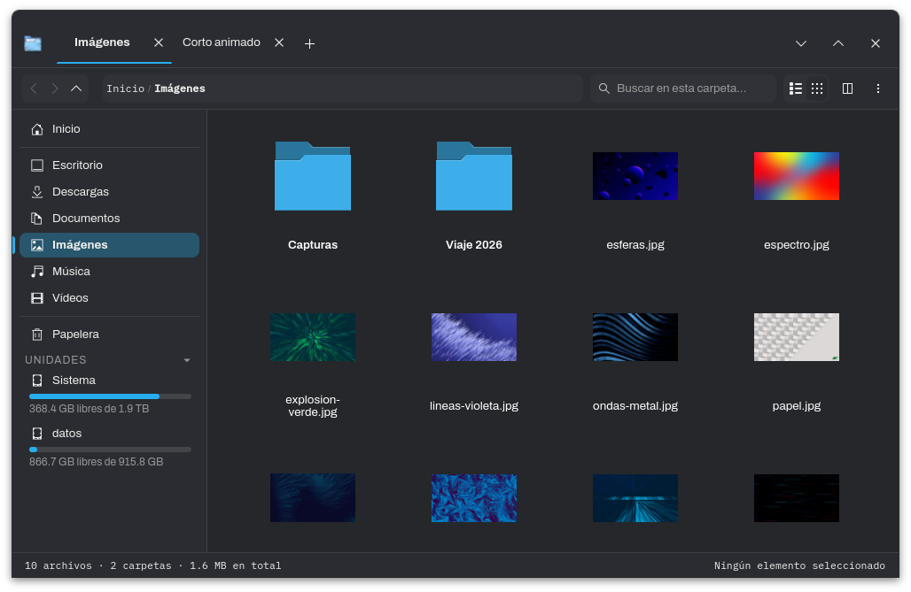

<p align="center">
  
</p>

<h1 align="center">Explorador</h1>

<p align="center">
  Un explorador de archivos para Linux, rápido y pensado para el día a día.
</p>

<p align="center">
  <a href="../../releases/latest"><b>Descargar la última versión</b></a>
  &nbsp;·&nbsp; Linux
</p>

<p align="center">
  
</p>

## Qué es

Explorador es un gestor de archivos hecho con GTK4 y Rust. Está pensado para KDE Plasma, pero funciona en cualquier escritorio con GTK 4.10 o más nuevo. Hace lo que esperas de un explorador, más algunas cosas que normalmente necesitan otra app.

## Lo que puedes hacer

**Moverte rápido**
- Pestañas que puedes sacar a su propia ventana, y vista dividida con dos paneles.
- Barra de ruta donde puedes pegar o escribir una dirección.
- Búsqueda por nombre o por contenido, sin importar mayúsculas ni tildes, con comodines como `*.png`.
- Vista previa rápida con la barra espaciadora.

**Trabajar con archivos**
- Copiar, mover y arrastrar con barra de progreso y botón para cancelar.
- Papelera real con restaurar, renombrado en lote y deshacer.
- Abrir comprimidos (zip, 7z, tar y otros) como si fueran carpetas.
- Miniaturas de fotos, videos, portadas de música y archivos de Blender, incluidos formatos como AVIF, HEIC o RAW de cámara.

**Mantener todo ordenado**
- Dejar notas en cualquier archivo o carpeta.
- Agrupar archivos relacionados bajo uno principal, por ejemplo un `.blend` con sus copias de seguridad.
- Ocultar archivos sin cambiarles el nombre.
- Una vista simple que limpia Descargas y muestra tus juegos y aplicaciones instaladas (Steam, Heroic, Flatpak, AppImage).
- Iconos propios por carpeta.

**Herramientas incluidas**
- Buscador de archivos duplicados.
- Analizador de espacio en disco.
- Propiedades con permisos, sumas de verificación y datos de cada tipo de archivo.

Si lo eliges como explorador predeterminado, el botón "Mostrar en la carpeta" del navegador, Discord o Steam abre una pestaña en Explorador.

## Instalación

Descarga `explorador-gtk-linux-x86_64.tar.gz` desde [Releases](../../releases/latest), descomprímelo y ejecuta el instalador:

```bash
mkdir explorador && tar -xzf explorador-gtk-linux-x86_64.tar.gz -C explorador
cd explorador
./instalar.sh
```

No pide contraseña de administrador: instala el programa en tu carpeta personal y lo añade al menú de aplicaciones. Para usarlo como explorador predeterminado (y abrirlo con Meta+E en KDE Plasma), ve a *Preferencias → Sistema → Explorador predeterminado*.

Para desinstalarlo, ejecuta `./desinstalar.sh` desde la misma carpeta. Tus notas, marcadores y preferencias quedan en `~/.local/share/explorador` por si vuelves.

### Requisitos

Linux de 64 bits con GTK 4.10 o más nuevo. Se compila en CachyOS (Arch), así que en distribuciones muy antiguas puede no arrancar.

Algunas funciones usan programas externos. Si no están instalados, esa función simplemente no aparece:

| Programa | Para qué |
|---|---|
| `p7zip` | Abrir y modificar comprimidos |
| `ffmpeg`, `ffmpegthumbnailer` | Miniaturas de video y formatos poco comunes |
| `imagemagick`, `librsvg`, `libavif` | Miniaturas de PSD, RAW, SVG y AVIF |
| `exiv2`, `poppler` | Datos de fotos y de PDF |

En Arch y derivadas se instalan todos con:

```bash
sudo pacman -S p7zip ffmpeg ffmpegthumbnailer imagemagick librsvg libavif exiv2 poppler
```

## Actualizaciones

Desde la app: *Preferencias → Sistema → Buscar actualizaciones*. Descarga la versión nueva y se reinicia sola.

---

Este repositorio solo publica los ejecutables; el código fuente es privado. Si algo falla o tienes una idea, abre un [issue](../../issues).
